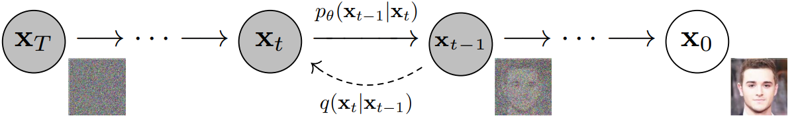

## DDPM

Diffusion is the process where we gradually convert a known distribution into a target distribution and the corresponding reverse process. Fortunately, people have proved that for gaussian distributions, we can convert data to noise and noise to data using the same functional form. 
<p align="center">
     
    <em>Figure 1. diffusion process</em>
    <br>
</p>

The core idea is simpler than the math in the papers makes it look: you add noise to an image, then train a network to guess what noise you added. The loss is just how wrong that guess was.

### Forward Process
As is shown in the figure above, there are two processes in diffusion:
- Forward diffusion process: we slowly and iteratively add Gaussian noise to the images
- Reverse diffusion process: we iteratively perform the denoising in small steps starting from a noisy image to convert it back to original form.

In the forward process (diffusion process), in each step, gaussian noise is added according to a variance schedule $ \beta_1, \dotsb, \beta_T $
$$
q(x_t|x_{t-1}) = \mathcal{N}(x_t; \sqrt{(1-\beta_t)}x_{t-1}, \beta_t\mathbf{I})
$$
And it's a Markov chain process, so
$$
q(x_{1:T}|x_0) = \prod_{t=1}^{T}q(x_t|x_{t-1})
$$
However, in implementation the above formulation has a problem because doing sequential sampling will result in inefficient forward process. The authors defined the following items:
$$
\alpha_t = 1 - \beta_t \\\
\bar{\alpha_t} = \prod_{s=1}^t\alpha_s
$$
Then we have
$$
q(x_t|x_0) = \mathcal{N}(x_t; \sqrt{\bar{\alpha}}x_0, (1 - \bar{\alpha_t})\mathbf{I})
$$
This process is called reparameterization. This allows us to directly sample $x_t$ from $x_0$ using a single sample of Gaussian noise:

$$
x_t = \sqrt{\bar{\alpha_{t}}}x_0 + \sqrt{1 - \bar{\alpha_{t}}} \epsilon
$$
Here $\epsilon \sim \mathcal{N}(0, I)$. Even though we know the distribution, we don't know the value of the noise. In practice, we use neural network to approximate this noise. 


#### Reparameterization
Reparameterization is used on both VAE and diffusion. It's needed because in diffusion, we have a lot of sampling operation and these operations are not differentiable. We use reparameterization to make it differentiable. Concretely, people introduce a random variable $\epsilon$, then we can sample from any gussian $z \sim \mathcal{N}(z; \mu_{\theta}, \sigma^2_{\theta}\mathbf{I}) $ as follows:
$$
z = \mu_{\theta} + \sigma_{\theta}  \odot \epsilon ; \epsilon \sim \mathcal{N}(0, \mathbf{I})
$$


### Reverse Process
Obviously, in reverse process we denoise the data and recover the images we have originally step by step. In the reverse process, we use the image at time $t$ to predict image at $t-1$, it follows the following distribution
$$
p_{\theta}(x_{t-1}|x_{t}) = \mathcal{N}( x_{t-1} ; \frac{1}{\sqrt{\alpha_{t}}}(x_t - \frac{1- \alpha_{t}}{\sqrt{1 - \bar{\alpha_{t}}}} \epsilon_{\theta}(x_t, t)); \frac{(1- \alpha_{t})(1 - \bar{\alpha_{t-1}})}{1 - \bar{\alpha_{t}}}\mathbf{I})
$$

Written as a sampling step, 

$$
x_{t-1} =  \frac{1}{\sqrt{\alpha_{t}}}(x_t - \frac{1- \alpha_{t}}{\sqrt{1 - \bar{\alpha_{t}}}} \epsilon_{\theta}(x_t, t)) + \sigma_tz,   \\
z \sim \mathcal{N}(0, \mathbf{I})
$$

Everything relates to $\alpha$ is a constant. 


### What is the Score

In generative modeling, the score of a probability distribution $p(x)$ refers to the gradient of the log-probability density with respect to the **input**:

$$
\nabla_x \log p(x)
$$

Unlike evaluating $p(x)$ directly which requires computing an intractable normalizing partition function Z where 

$$
p(x) = \frac{\tilde{p}(x)}{Z}
$$

The score bypasses normalization entirely because $\nabla_x \log Z = 0$

A neural network trained to approximate this vector field $\nabla_x \log p(x)$ points in the direction where probability mass increases most rapidly. 


### Diffusion Learns the Score

For a Gaussian $\mathcal{N}(\mu, \sigma^2\mathbf{I})$, the score is $\nabla_x \log q = - (x-\mu)/\sigma^2$.

Here is the step-by-step derivation for the score of a Gaussian distribution, defined as the gradient of the log-density $\nabla_x \log q(x)$.


Step 1: Write the Probability Density Function (PDF)

For a multivariate Gaussian distribution $q(x) = \mathcal{N}(\mu, \sigma^2\mathbf{I})$ in $d$ dimensions, the PDF is given by:

$$q(x) = \frac{1}{(2\pi \sigma^2)^{d/2}} \exp\left( -\frac{1}{2\sigma^2} (x - \mu)^T (x - \mu) \right)$$


Step 2: Take the Logarithm

To find the log-density $\log q(x)$, apply the natural logarithm to both sides. Using logarithm properties ($\log(ab) = \log a + \log b$ and $\log(e^c) = c$):

$$\log q(x) = -\frac{d}{2} \log(2\pi) - \frac{d}{2} \log(\sigma^2) - \frac{1}{2\sigma^2} (x - \mu)^T (x - \mu)$$


Step 3: Compute the Gradient with Respect to $x$

The score is the gradient of the log-density, $\nabla_x \log q(x)$. Let's differentiate term by term:

$$\nabla_x \log q(x) = \nabla_x \left[ -\frac{d}{2} \log(2\pi \sigma^2) - \frac{1}{2\sigma^2} (x - \mu)^T (x - \mu) \right]$$

1. **Constant terms:** The normalization constant $-\frac{d}{2} \log(2\pi \sigma^2)$ does not depend on $x$, so its gradient is $0$.
2. **Quadratic term:** Using the vector calculus identity $\nabla_x \left( (x - \mu)^T (x - \mu) \right) = 2(x - \mu)$, we differentiate the second term:

$$\nabla_x \log q(x) = -\frac{1}{2\sigma^2} \cdot 2(x - \mu) = -\frac{x - \mu}{\sigma^2}$$


Simplifying the expression yields the final score function:

$$\nabla_x \log q(x) = -\frac{x - \mu}{\sigma^2}$$


As we know that given $x_0$, $x_t$ is Gaussian,
$$
q(x_t|x_0) = \mathcal{N}(x_t; \sqrt{\bar{\alpha}}x_0, (1 - \bar{\alpha_t})\mathbf{I})
$$

We can easily derive,
$$
\nabla_x \log q(x_t | x_o)  = -(x_t - \sqrt{\bar{\alpha}_t}x_0) / (1 - \bar{\alpha_t}) = - \epsilon / \sqrt{(1-\bar{\alpha}_t)}
$$

The noise $\epsilon$ points from the clean image towards the noisy one, so $-\epsilon$ points back toward clean data. The score of the conditional distribution is just the "denoising direction", rescaled.


Training loss is defined as 

$$
L = E\|\epsilon_{\theta}(x_t, t) - \epsilon \|^2
$$

For any fixed $x_t$, the function that minimizes squared error is the conditional mean. So the best possible network is 
$$
\epsilon_{\theta}^*(x_t) = E(\epsilon | x_t)
$$

### Training Steps
1. Take a clean training image, call it $x_0$.
2. Pick a random timestep t (say between 1 and 1000). Small t means a little noise, large t means almost pure static.
3. Sample random Gaussian noise $\epsilon$, the same shape as the image.
4. Mix them: $x_t = \sqrt{\bar{\alpha_{t}}}x_0  + \sqrt{1 - \bar{\alpha_{t}}} · \epsilon $. Here $\bar{\alpha_{t}}$ is a fixed schedule number that goes from about 1 (mostly image) down to about 0 (mostly noise) as t grows.
5. Give the network the noisy image $x_t$ and the timestep $t$, and ask it to output its guess of $\epsilon$.
6. $ Loss = \|\epsilon − \epsilon_{\theta}(x_t, t)\|^2$, the mean squared error between the real noise and the predicted noise.  $\epsilon_{\theta}(x_t, t)$ is network predicted noise and $\epsilon$ is noise sampled from schedule.


### Sampling

The goal of the backward process:

> Given the noisy image x_t, draw a sample of x_{t-1} from p(x_{t-1} | x_t).

1. The key idea: what we would like to sample from

The forward process adds noise in closed form:

```
x_t = sqrt(ᾱ_t) · x_0 + sqrt(1 − ᾱ_t) · ε
```

2. To go backwards we want the reverse distribution `q(x_{t-1} | x_t)`. We can't compute it, because it depends on the whole data distribution.

However, if we also knew `x_0`, the reverse step has an exact answer. Apply Bayes' rule to the forward process:

```
q(x_{t-1} | x_t, x_0) = N( μ̃_t, β̃_t I )

μ̃_t = [sqrt(α_t)(1 − ᾱ_{t-1}) / (1 − ᾱ_t)] · x_t  +  [sqrt(ᾱ_{t-1}) β_t / (1 − ᾱ_t)] · x_0
                 └────────── coef1 ──────────┘            └──────── coef2 ────────┘

β̃_t = (1 − ᾱ_{t-1}) / (1 − ᾱ_t) · β_t
```

The trick: we don't know `x_0`, but the network can estimate it. It is trained to predict the noise `ε` that was added, so we can invert the forward equation:

```
x̂_0 = (x_t − sqrt(1 − ᾱ_t) · ε_θ) / sqrt(ᾱ_t)
```

Then we plug `x̂_0` into the exact posterior. That is the whole algorithm: predict noise → estimate x_0 → get mean and var, take the Bayes-optimal step toward it, adding the right amount of fresh noise.


3. Sampling a Gaussian is mean plus scaled noise.

To draw a sample from `N(μ, σ²)`, you compute

```
x = μ + σ · z,    z ~ N(0, 1)
```

This is the standard way to sample a Gaussian (the reparameterization trick). Returning only `μ` doesn't give you a sample. It gives the single most likely value, which is a point estimate.


At each step the network guesses the noise, and we use that guess to estimate the clean image `x̂_0`. We then step to the exact Gaussian posterior `q(x_{t-1} | x_t, x̂_0)`: move to its mean, a blend of `x_t` and `x̂_0`, and add fresh noise of variance `β_t` or `β̃_t`. Repeating this from t = T−1 down to 0 turns pure noise into an image.


Start from pure noise $x_T \sim \mathcal{N}(0, I)$, then step from $t = T - 1$ down to 0:

$$
x_{t-1} = \mu_\theta (x_t, t) + \sigma_t z, \quad z \sim \mathcal N(0, I)
$$
This removes the noise and estimate clean image.


Each step doing the three things

1. Predict the noise

```python
eps = net(x_t, t)
```
The noise is network's guess for all the noise that turned $x_0$ into $x_t$. It is used only to compute the mean, i.e. to estimate where the image should be one step cleaner

$$
x_0 = (x_t - \sqrt{1-\hat{\alpha_t})} * eps / \sqrt{\alpha_t}
$$

```python
mean = coef1 * x_t + coef2 * x_0  # move partway from x_t towards x_0
```
So `eps` is a denoising direction, not something we add.

2. Pick the noise to add.

$\sigma_t^2$ is either $\beta_t$ or $\hat{\beta_t}$. At $t=0$, no noise is added, so the output is clean.

3. Compute mean

$$
\mu_\theta(x_t, t) =  \frac{1}{\sqrt{\alpha_{t}}}(x_t - \frac{1- \alpha_{t}}{\sqrt{1 - \bar{\alpha_{t}}}} \epsilon_{\theta}(x_t, t)) 
$$


## Classifier-free Guidance

A diffusion model learns the score $\nabla_x \log p(x_t)$ , which is equivalent to predicting the noise $ \epsilon(x_t, t) $. For conditional generation, you want $\nabla_x \log p(x_t | y)$. By Bayes' rule:

$$
\nabla_x \log p(x_t | y) = \nabla_x \log p(x_t) + \nabla_x \log p(y | x_t)
$$

Guidance multiplies the second term by a scale $w > 1$, which pushes samples harder towards $y$.

With classifier free guidance, we train a network $\epsilon_{\theta}(x_t, t, y)$ with the condition randomly dropped to a null token $\varnothing$ (e.g. 10-20% of the time). The same model then learns both the conditional and unconditional scores. 

At sampling time, run the model twice and extrapolate between the two predictions:

$$
\hat{\epsilon} = \epsilon_{\theta}(x_t, \varnothing) + w (\epsilon_{\theta}(x_t, y) - \epsilon_{\theta}(x_t, \varnothing)  )
$$

when $w=1$, it gives plain conditional sampling.
w > 1 (often 3-1= in text-to-image models) strengthens adherence to the condition. This works because $\epsilon(x, y) - \epsilon(x, \varnothing)$ is proportional to $\nabla_x \log p(y | x)$ so the model acts as its own implicit classifier. 

Classifier guidance puts a weight w on the classifier term, score of $p(x_t) * p(y|x_t)^w$
$$
\tilde{s} = \nabla \log p(x_t) + w \nabla \log p(y | x_t)
$$

Why it's called classifier, because $p(y|x)$ predicts label (prompt). This is only part that is depends on the prompt. So basically this equation means that for conditional generation, it depends on the latents and prompt (steering term).

The steering term is the gradient of a classifier-like probability $p(y|x_t)$


## Flow Matching

Flow matching trains a network to predict a velocity field that carries noise samples to data samples along simple paths. The loss is plain regression on that velocity

### Setup

- $x_0 \sim \mathcal{N}(0, I) $  is noise, and $x_1 \sim p_{data}$ is a data sample
- Pick a path between them. The most common is a straight line (rectified flow / optimal-transport path): $ x_t = (1-t)x_0 + t x_1, \quad t \in [0 , 1] $
- Along this path the velocity is constant: $\frac{dx_t}{dt} = x_1 - x_0$

### Loss

Train $v_{\theta}(x_t, t)$ to predict that velocity:

$$
\mathcal{L} = E_{t, x_0, x_1}[(v_{\theta}(x_t, t) - (x_1 - x_0))^2]
$$

```python
x1 = batch  # data
x0 = torch.randn_like(x1)  # noise
t = torch.rand(x1.shape[0], 1, 1, 1)
xt = (1-t)x0 + t * x1
target = x1 - x0
loss = ((model(xt, t) - target) ** 2).mean()
```

What you actually want is the marginal velocity field $u_t(x)$ : the average direction mass moves through point $x$ at time $t$, taken over every (noise, data) pair whose path passes through x. Integrateing that field from $t=0$ to 1 turns the noise distribution to the data distribution. You can't compute it because it requires marginalizing over the whole dataset.

The conditional flow matching result says that regressing on the per-pair velocity $(x_1 - x_0)$ has the same gradients as regressing on the intractable marginal $u_t(x)$. MSE's minimizer is a conditional expectation, so the network learns $ v_\theta(x, t) \approx \mathbb{E}[x_1 - x_0 \mid x_t=x] = u_t(x)$
In short, individual targets are noisy, but the network learns their average, and the average is the correct field.

### Sampling

Start from noise and integrate the OED with any solver (e.g. Euler):

```python
x = torch.randn(shape)
for i in range(N):
    t = i / N
    x = x + model(x, t) / N
```


### Time Embedding

1. Frequencies

$$
\omega_i = 10000^{-i/H} = \exp\left(-\frac{\ln 10000 \cdot i}{H}\right), \qquad i = 0, 1, \dots, H-1
$$

The frequencies form a geometric sequence from ω₀ = 1 down to ω₁₂₇ = 10000^(-127/128) ≈ 1.07×10⁻⁴. 

2. Sinusoidal features

$$
\text{PE}(t) = \big[\cos(\omega_0 t), \dots, \cos(\omega_{H-1} t),; \sin(\omega_0 t), \dots, \sin(\omega_{H-1} t)\big] \in \mathbb{R}^{F}
$$


## References
1. [Denoising Diffusion Probabilistic Models](https://arxiv.org/pdf/2006.11239.pdf) <br>
2. [Understanding Diffusion Models: A Unified Perspective](https://arxiv.org/abs/2208.11970) <br>
3. [Transfusion: Predict the Next Token and Diffuse Images with One Multi-Modal Model](https://www.arxiv.org/pdf/2408.11039)

